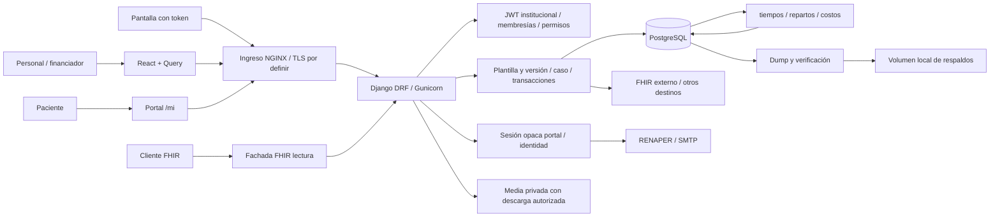

# Auditoría de ingeniería, seguridad y preparación para escala

Fecha: 14/10/2026, America/Buenos_Aires. Corte de fuentes: `c6f101b089ee4950e6133390bd4c888a280f31b5`.

## Dictamen y límites

**No preparado para incorporar datos sensibles reales y operar con alta disponibilidad en la configuración inspeccionada. Evidencia insuficiente para certificar capacidad de 1.000, 5.000 o 10.000 usuarios concurrentes.** El dictamen se refiere al código y configuración versionados, no a un despliegue AWS existente. El dueño confirmó que no hay producción. No se identificó un incidente activo ni se asignó P0.

Los bloqueantes más concretos son la autoridad sobre credenciales de usuarios compartidos (AUD-001), el envío de JWT a un origen controlado desde un estudio (AUD-002), la descarga clínica sin auditoría (AUD-003), las fronteras de integraciones/eventos (AUD-005–008), la mutación concurrente del grafo publicado (AUD-011) y la unicidad de stock sin lote (AUD-013). Recuperación verificable, configuración productiva y operación disponible también necesitan trabajo antes de producción (AUD-015–018, 023–026, 031–032, 035–036). La revocación institucional necesita prueba del runtime y un contrato explícito (AUD-009). La ampliación agrega bloqueantes de firma clínica concurrente, administración, atribución de auditoría, FHIR multiinstitucional, reset de escuela y asociación de adjuntos con paciente (AUD-041/042/044/046/047/050). Ninguno implica un incidente activo: no hay producción según el dueño.

El producto es un diagnóstico estático transversal y un plan controlable. **La auditoría integral permanece abierta en sus validaciones dinámicas y áreas de profundidad parcial.** Mapear todas las áreas no significa haber revisado todas las líneas, roles, acciones y combinaciones. No se promete encontrar todos los defectos. Ninguna corrección, migración, dependencia, permiso, dato, servicio ni infraestructura fue modificada.

Inventario único: [2026-10-14-auditoria-ingenieria-inventario.csv](2026-10-14-auditoria-ingenieria-inventario.csv). Contiene 54 entradas estables, incluidas acciones de conservación y validaciones pendientes; **no son 54 vulnerabilidades confirmadas**. Cada fila conserva escenario, evidencia, propuesta mínima, dependencias, esfuerzo incierto, responsable por definir, aceptación, prueba, riesgo y reversión. Ninguna figura como resuelta. Los días estimados son esfuerzo técnico orientativo, no calendario, presupuesto ni compromiso; excluyen aprobaciones, adquisición y tiempos de proveedores.

Resultado del control documental: 33 entradas P1, 20 P2 y 1 P3; 44 propuestas y 10 pendientes de confirmar. Las referencias abreviadas dentro de una ubicación del CSV continúan bajo `backend/apps/` o `frontend/src/` según el primer archivo del recorrido. Para implementar, resolver siempre contra este SHA y no trasladar números de línea a otro commit sin revisar.

## Base, método y fuentes

- Cwd: `C:\Users\Juanito\orca\workspaces\SistemaDeSalud\Auditor`.
- Rama: `juanikitro/Auditor`. HEAD y referencia **local** `origin/main`: `c6f101b089ee4950e6133390bd4c888a280f31b5`; coinciden con la base solicitada. No se hizo fetch ni se verificó el remoto en vivo. El commit registra 13/10/2026; 14/10 es la fecha de preparación/auditoría, no una divergencia de SHA.
- Estado inicial: `git status --short` vacío. Se preservó trabajo ajeno. Se buscaron AGENTS versionados y en ancestros: no aparecieron archivos adicionales; se aplicaron las instrucciones entregadas en conversación.
- Se comenzó por README, CONTEXT y los ocho documentos solicitados de estado, despliegue, pruebas, datos, permisos, cumplimiento, integración y frontend. Lectura orientada por secciones y contrastes; salidas largas se truncaron, por lo que se releyeron secciones relevantes y no se atribuye lectura exhaustiva a cada documento.
- Se siguieron rutas/router, permisos, serializers, servicios, modelos/migraciones, tareas, archivos y consumidores frontend de los recorridos prioritarios. El historial local se usó para fijar procedencia, no como prueba de corrección.
- Skills revisadas: `using-superpowers` se aplicó para selección de flujo; `code-review` se descartó por exigir revisión de diff, ajena al mandato integral. No se ejecutó su delegación ni se creó un proceso paralelo de revisión. No se incorporaron herramientas nuevas. La memoria de padrón sirvió para localizar fronteras y evitar confundir pruebas previas con evidencia actual; se contrastó el código actual.
- No se abrieron `.env`, credenciales, bases, adjuntos ni logs reales. Los literales de ejemplos/CI vistos al leer configuración no se reproducen aquí. No se inspeccionó el historial completo buscando secretos ni se afirma su ausencia.
- No se consultaron servicios externos, advisories, precios AWS ni normativa actual. No se atribuye ninguna CVE ni cumplimiento jurídico sin fuente vigente y evaluación autorizada. Este informe plantea decisiones legales, no asesoramiento jurídico.

### Stack comprobado

| Evidencia | Resultado y límite |
|---|---|
| `backend/requirements.txt` | Django `>=5.0`; DRF, SimpleJWT, psycopg y Gunicorn sin pin; openpyxl/defusedxml acotados. No lock Python observado. No prueba versiones instaladas. |
| `backend/Dockerfile` | Python `3.12-slim`, cliente PostgreSQL major 16, Gunicorn con 3 workers; no USER explícito. |
| `docker-compose.yml` | PostgreSQL `16-alpine`, backend, frontend y tiempos/repartos/costos/respaldos; volúmenes locales. |
| `frontend/package-lock.json` | React 18.3.1, Vite 5.4.21, TanStack Query 5.101.4, Tailwind 4.3.3. Resolución del lock, no instalación verificada. |
| `frontend/Dockerfile` | Build Node 20 con npm ci; runtime NGINX 1.27 Alpine. |
| Herramientas locales usadas | Python 3.14.6 y Node 24.13.0, distintas de las imágenes. Sólo ejecutaron comprobaciones puras, no Django ni el build. |
| Censo versionado | 16 directorios de apps, 454 archivos Python backend, 115 archivos de migraciones excluyendo `__init__`, 147 archivos frontend/src, 67 registros del router central; acciones, admin, portal y FHIR agregan más endpoints. No son cifras de rutas totales ni de cobertura. |

## Contexto confirmado y decisiones abiertas

El dueño declara 1.000–10.000 usuarios registrados/recurrentes, unas 1.000 instituciones, alta actividad de 08 a 20, AWS probable, equipo de 1–4 personas y deseo de alta disponibilidad. **No confirmó 1.000–10.000 usuarios simultáneos**. Tampoco aprobó consumir servicios AWS, asumir nuevos costos ni ejecutar fallos/carga.

Preguntas abiertas, reunidas en un único registro para evitar repetir solicitudes:

| ID | Falta confirmar | Qué conclusión bloquea |
|---|---|---|
| Q-01 | Activos simultáneos, pestañas/dispositivos por persona, sesiones, actividad/pausas, instituciones grandes y concentración | Conversión de población a demanda y reparto de carga. |
| Q-02 | Mezcla por recorrido, RPS, ráfagas y reconnect; tamaño de historias/documentos, crecimiento, exportaciones/importaciones | Dataset, consultas calientes, límites, CPU/memoria/IO y almacenamiento. |
| Q-03 | p95/p99 de ingreso, fila, avance clínico, reserva, descarga, autorización/cobro y exportación; frescura de datos | Aprobación de latencia API y experiencia percibida. |
| Q-04 | Error admisible y SLO de disponibilidad, ventana de cálculo, mantenimiento, fallos que debe tolerar y horario de guardia | Arquitectura disponible y umbrales de aborto/alerta. “Alta” no es un porcentaje aprobado. |
| Q-05 | RPO/RTO por DB, archivos y efectos económicos/externos | Backup, PITR, failover y recuperación. |
| Q-06 | Región/jurisdicción, presupuesto mensual y de pruebas, responsables/on-call, servicios/proveedores y límites contractuales | Diseño AWS, residencia, cifrado, continuidad y costo sostenible. |
| Q-07 | Autoridad sobre identidad global, estabilidad de formularios, política de lectura si auditoría falla, sesiones y accesos excepcionales | Remediaciones que cambian seguridad, contratos o conducta clínica. |

No se bloquearon inspecciones estáticas por estas incógnitas. Las propuestas del CSV son recomendaciones del auditor, no decisiones humanas aceptadas.

## Mapa y fronteras de confianza



Fronteras: navegador no es autoridad de permisos; la institución no se decide sólo por parámetro; cuenta de usuario global y membresía institucional son objetos distintos; membresía de financiador no concede datos clínicos universales; JWT institucional y sesión portal no son intercambiables; superusuario real y cuenta simulada conservan identidades distintas. Media y backups contienen datos sensibles aunque la API los oculte. El administrador DB/host está fuera de las garantías del hash de integridad. Cada proxy y destino externo tiene una frontera adicional de confianza.

La ruta FHIR del diagrama es lógica: el NGINX Compose inspeccionado no la proxea (AUD-024). No se da por existente un balanceador, TLS, storage compartido, RDS, cola o monitor AWS.

### Recorridos e invariantes seguidos

| Recorrido | Cadena inspeccionada | Control / brecha |
|---|---|---|
| Gestión de usuario | UI/directorio → usuarios → CapacidadPermission/get_queryset → UsuarioSerializer → Usuario global → nuevo login | Lectura acotada por membresías, pero autoridad de escritura global defectuosa: AUD-001. |
| Estudio/archivo | HistoriaDetalle → estudios PATCH → permiso clínico → Estudio.archivo → downloadArchivo → fetch / FileResponse | Token externo y falta de auditoría directa: AUD-002/003. MIME/tamaño/firma de upload existen. |
| Ejecución configurable | editor → publicar/nodos/conexiones → diseño institucional → versión/grafo → avanzar atomic → condición/efecto → EventoCaso | Guarda borrador y lock parcial; carreras, formulario compartido y salida externa: AUD-005/006/008/011/012. |
| Agenda / internación / red | UI operativa → acciones → permisos institucionales → motor → agenda/turno o caso/cama/traslado bajo lock → caso/evento | Controles conservables AUD-038; cruces/reintentos/camas opuestas aún requieren PG. |
| Farmacia | ingreso/transferencia → MovimientoViewSet → autorización de insumo/depósito → motor atomic → existencia/movimiento → respuesta | Validación y lock existentes; NULL único y orden opuesto AUD-013/014. |
| Padrón / cobertura | ficha/importación/exportación → organización y membresía → servicios → revisión/locks → historial separado o XLSX → auditoría | AUD-037; importación v1/v2, sin bajas implícitas; límites de planilla; legacy pendiente AUD-035. |
| Dinero / reparto | formulario → endpoint y concesión → obligación/clave/contenido → transacción → TrabajoReparto → worker → versión/reporte | Idempotencia y fuente durable; conciliación global AUD-019; costos tienen proceso propio. |
| Portal | /mi → autenticador propio → cuenta/identidad → sesión hasheada y revocable → datos/archivo propios → acceso | Controles distintos del JWT; correo daemon y throttles pendientes AUD-028/029/040. |
| Backup / salud | bucle → respaldar → dump → restore en DB fija → conteo → rotación/latido → estado | AUD-015–018; no cubre media ni copia externa. |

## Matriz de cobertura acumulada

“Revisado” significa recorrido estático delimitado, no módulo certificado. “Parcial” identifica ramas o pruebas faltantes; no significa ausencia de controles.

| Área / componentes | Cobertura | Evidencia y pendiente |
|---|---|---|
| Config, router, Compose, Dockerfiles, NGINX, entrypoint, CI | Revisado estático en superficies relevantes | Versiones/configuración/manifiestos; no imagen instalada, configuración efectiva ni CI remoto. |
| accounts y common | Revisado alcance de usuarios, capacidad, upload/download/CSV; parcial resto | Admin Django ampliado en AUD-042; falta matriz completa de membresías, cambios simultáneos y sesiones en runtime. |
| instituciones | Parcial | Modelos cama/estadía, asignación, Box.ocupar/liberar y reset_escuela; no cada tablero/consulta ni estado público completo. AUD-047/048. |
| flujos / formularios / casos | Revisado publicación/mutación/avance/integración; parcial resto | Condiciones sin eval observado, ciclos automáticos detectados; faltan límites de grafo/recursión y todos los tipos de nodo. |
| agenda | Parcial con motor principal leído | Reserva/reprogramación y releer turno; constraints presentes. Ampliado cruce portal/reprogramación AUD-049. Pruebas de último cupo y cancelar/llegada no ejecutadas. |
| farmacia | Parcial con existencias/transferencias trazadas | Ampliados FEFO, preparación/entrega/rechazo, serializer y DELETE de pedido; AUD-052–054. No se certifica concurrencia ni trazabilidad de todas las operaciones. |
| red / derivaciones | Parcial | Scope origen/destino y releer traslado; falta aceptación/rechazo/llegada cruzados y reconciliación de identidad destino bajo concurrencia. |
| registros / auditoría | Parcial | Permiso clínico, historia fija, firma/edición/suspensión, canónico, admin, IP, archivos/consentimientos y comando de retención leídos. AUD-041–045/050. Faltan accesos excepcionales y ejecución de errores/concurrencia. |
| financiadores / padrón | Revisado fronteras y servicios focales; parcial cobertura total | Recursos sensibles, revisión, locks, XLSX, importación incremental y compatibilidad leídos; ampliados resolución/revisión/clave y registrar_uso con locks; faltan pruebas reales y todas las combinaciones de autorizaciones/consumos. |
| finanzas | Parcial | Dinero/clave/contenido, obligación, repartos, listener y reporte de procesamiento; ampliados registrar/aprobar/rechazar gasto y registrar/reducir dinero. No revisados íntegramente todos los reportes, cálculos, concesiones ni cierres. |
| FHIR | Parcial | Cliente saliente y Patient/Encounter read/search trazados: scoping de membresía no garantiza capacidad institucional (AUD-046). TOPE/auditoría presentes; perfiles y autenticación de integradores pendientes. |
| portal | Parcial | Tokens/enlaces/recuperación/identidad/throttle/correo, frontend propio; ampliados persona_de, turnos, llamado, resultados/descarga y cobertura. AUD-049–051. Proveedor real, tiempos de enumeración y matriz completa por paciente pendientes. |
| demo / simulación | Parcial | Autenticador, flags/entornos y reset leído (AUD-047); no ejecución de seeds/reset ni lectura exhaustiva de generadores. Simulación puede operar datos reales; no usar como sandbox. |
| frontend | Parcial transversal | Cliente/queries/auth/ámbito/polling/descargas; no build, tamaños reales, todas las mutaciones, accesibilidad ni aceptación visual. |
| PostgreSQL y migraciones | Parcial estático | Constraints/locks focales y migración compatible padrón; 115 migraciones no revisadas una a una. Sin catálogo real, planes, bloat/vacuum, locks medidos. |
| AWS, TLS real, observabilidad, backups externos, restauración | No revisado en vivo | No desplegado según dueño, sin acceso autorizado; diseño/ejercicios pendientes. |
| Secretos / datos reales / exposición activa | No inspeccionado por límite explícito | No escaneo de credenciales ni acceso a personas reales. No garantía de ausencia. |

## Controles que conviene conservar

No comenzar con una reescritura. La API tiene scoping institucional por membresías activas, protección de lectura clínica en recursos específicos, permisos sensibles de padrón separados, validación de campos admitidos y revisión optimista con conflicto. HistoriaFija evita mover asientos de paciente por PATCH. El grafo publicado tiene guardas y varios locks, aunque faltan caminos. Agenda relee turnos bajo lock, stock usa transacciones y movimientos, dinero contrasta la clave con el contenido económico. Hay paginación y desempate estable, prefetch de historia clínica y límites FHIR; evitar afirmar N+1 generalizado donde ya hay prefetch.

El XLSX de padrón limita 5.000 registros, fuerza texto, excluye recursos sensibles, audita antes de entregar y usa no-store. La importación limita archivo/expansión/entradas/filas/tiempo y aplica hasta 100 filas o 10 segundos por invocación con recuperación por fila; no es un importador ilimitado ni una cola autónoma. Protecciones de v1/v2 y db_defaults no deben eliminarse por simplificación estética.

Repartos persiste solicitud junto a la fuente, usa revisión/reserva y `skip_locked`, escucha antes de conciliar y consulta pendientes aunque no llegue NOTIFY. **NOTIFY despierta; TrabajoReparto es la cola.** Caída del listener provoca salida y Compose tiene restart; efectividad en plataforma futura pendiente. Health usa SELECT 1 y estado funcional tiene latidos; mejorar esa práctica, no crear otro tablero duplicado. Portal comparte límites en DatabaseCache, usa tokens opacos hasheados y revocación, consumo condicional de enlaces y separación de autenticadores; no trasladar las conclusiones de JWT a ese portal.

## Prioridad, probabilidad y exposición

P0 exige exposición/pérdida crítica activa o inminente: ninguna demostrada. P1 bloquea el uso sensible o el incremento de escala indicado, incluso si su explotación requiere cuenta autenticada. P2 es mejora necesaria o validación de riesgo limitado; P3 deuda secundaria. Una validación P1 pendiente es una puerta de aprobación, no una vulnerabilidad confirmada. Las filas de conservar usan P2 como prioridad de regresión, no severidad de defecto.

| Grupo | Impacto / probabilidad condicionada / exposición |
|---|---|
| AUD-001/002 | Toma de identidad/token; probabilidad media con actor interno o cuenta comprometida; exposición de administración y clínica autenticadas. P1 por acceso adicional posible. |
| AUD-003/007/008 | Pérdida de trazabilidad/minimización; alta al usar el recorrido configurado; archivos/logs/eventos, con 007/008 condicionados a integración. P1 antes de datos reales. |
| AUD-005/006 | Red interna/efecto remoto incoherente; media con proveedor habilitado; deshabilitado por allowlist vacía inicialmente. P1 para habilitar integración, no incidente activo. |
| AUD-009/010 | Credenciales reutilizables y agotamiento; media/alta tras exposición pública; límite externo desconocido. P1 por impacto sobre autenticación/servicio. |
| AUD-011/012/013 | Definición clínica o stock inconsistente; media al editar/publicar o crear stock concurrentemente; actores autorizados. P1 por integridad. AUD-014 afecta disponibilidad transaccional y requiere reproducción: P2. |
| AUD-015/016/017/018 | Recuperación falsa/incompleta o tarea invisible; alta si se adopta tal cual el procedimiento; operación y fallos. P1 porque HTTP y dump no sustituyen recuperación. |
| AUD-019/021/022 | Saturación creciente; probabilidad no cuantificada sin volumen; workers, DB y navegador. P2 y medición prioritaria antes de carga. |
| AUD-020/023/024/026/031/035/036 | Capacidad/release/ingreso/operación no demostrados; riesgo condicionado a despliegue elegido. P1 para liberar producción/escala. |
| AUD-004/025/027/028/029/030/034 | Seguridad, entrega, operación y UI mejorables; escenarios concretos o hipótesis delimitadas en CSV. P2; no actualización ni nueva dependencia automática. |
| AUD-032/039 | Autoridad y cobertura insuficientes; probabilidad no estimable. P1 como decisiones/evidencia necesarias; no certificación legal ni certeza de vulnerabilidad. |

### Intercalaciones que debe reproducir el próximo lote

1. **AUD-001:** actor con admin A y rol no admin B → `GET/PATCH usuarios/{usuarioB}` → queryset admite B y permiso usa capacidad de A → serializer cambia password global. El test existente de usuario exclusivamente ajeno no cubre esta combinación. No cambiar el permiso hasta confirmar autoridad deseada sobre cuentas compartidas.
2. **AUD-002:** PATCH de estudio propio con URL externa → otro clínico usa descargar → fetch coloca bearer en ese origen. La prueba aislada sólo prueba construcción de request, no CORS/navegador completo; el servidor externo tendría que permitir el preflight.
3. **AUD-011:** escritura conexión lee borrador → publicar toma lock/revalida/commit → escritura persiste sobre versión publicada. Borrado de nodo tiene ventana equivalente. El bloqueo de Nodo.create/update no cubre esos caminos.
4. **AUD-013:** dos transacciones ven inexistencia con lote NULL → ambas insertan bajo unicidad que distingue NULL → dos saldos; first no reconcilia. Verificar con PostgreSQL, no SQLite.
5. **AUD-015:** dump snapshot t0 → atención nueva t1 → restore snapshot → comparación con original t2 difiere aunque dump sea válido. Separadamente, dos conteos fallidos no pueden ser evidencia de igualdad.
6. **AUD-006:** POST remoto confirmado → siguiente nodo falla → rollback local → retry vuelve a emitir. Una transacción de DB no deshace el POST.

## Plan por dependencias

| Lote | Acciones y ámbito | Condición de salida |
|---|---|---|
| A. Contención antes de exposición | Código: AUD-001/002/003/007/008/009/010. Configuración: mantener integración sin habilitar hasta AUD-005/006; evitar perfil desarrollo público. Operación: no cargar datos reales todavía. | Contratos de identidad/sesión/auditoría aprobados, negativos y positivos con datos sintéticos. No hay incidente productivo que contener según información disponible. |
| B. Integridad y recuperación | Código/migración: AUD-011/012/013/015/016; reproducir AUD-014. Infra/operación: AUD-017/018/023/024/026/035. | PG concurrente y restauración integral pasan criterios aprobados; rollback/release ensayados. |
| C. Antes de aumentar carga | AUD-019/020/021/022/025/027/028/029/030/031/034/036; conservar AUD-037/038/040. | Mezcla/SLO/RPO/RTO/costo definidos, capacidad medida y margen bajo fallo; carga no suplanta integridad. |
| D. Posterior y sostenimiento | AUD-033, mantenimiento de dependencias, índices sólo medidos, retención/capacidad y simulacros periódicos. AUD-032/039 atraviesan todos los lotes y no se posponen si hay datos sensibles. | Responsable asignado, evidencia por SHA y riesgo residual aceptado por dueño clínico/seguridad/operación apropiado. |

**Siguiente lote recomendado:** confirmar política de identidad y archivos; reproducir AUD-001/002/003/011/013 en entorno sintético PostgreSQL exclusivo y corregir en lotes pequeños sólo tras autorización. En paralelo lógico, el dueño define Q-03–Q-07. No se recomienda aún merge, despliegue ni incorporación de cambios: no se implementaron. Antes de incorporar una remediación se confirmarán intención, aceptación observable y comprensión de qué falla, cómo se detecta y revierte, conforme a las instrucciones del proyecto.

No elegir caché/pooler/réplica de lectura/particionamiento por intuición. Primero identificar consulta, frecuencia, tamaño, plan y costo; después decidir consistencia, invalidación, retraso y operaciones. Una réplica de lectura atrasada puede ser inapropiada para cupos/stock. LISTEN necesita sesión persistente y no puede suponerse compatible con pooling transaccional. Para 1–4 personas se debe comparar costo operativo de servicios administrados mínimos con mantener el monolito actual; AWS “completo” no es requisito ni decisión aprobada.

## Plan reproducible de capacidad y recuperación — no ejecutado

### Demanda y escenarios exploratorios

Los siguientes números son **escenarios no aprobados de concurrentes activos**, no una reinterpretación de usuarios registrados. La demanda se calcula a partir de actividad medida:

`RPS = Σ(N_activos × fracción_recorrido × acciones_por_segundo × requests_por_acción) + Σ(pestañas_visibles × polls_por_ciclo / intervalo) + integraciones + tareas + reintentos`.

Separar usuarios humanos, conexiones TCP, peticiones en vuelo y conexiones DB. Medir fan-out real en navegador; conteo de una acción puede incluir lista, detalle, permisos, resumen y auditoría. No sumar polls que TanStack realmente deduplica en la misma pestaña; otras pestañas y dispositivos cuentan aparte.

Ejemplo **aritmético, no objetivo ni forecast**: si el 50% de N abre una vista que hace 2 consultas cada 30 segundos, ese componente solo aporta N/30 RPS: 33,3 para 1.000; 166,7 para 5.000; 333,3 para 10.000. Si toda esa población abre una consulta cada 3 segundos, son N/3: 333,3; 1.666,7; 3.333,3 RPS, antes de acciones/reintentos. Pantallas de TV e importaciones requieren su propio conteo. No existe una equivalencia única usuarios→RPS.

| Escenario | Diseño exploratorio | Evidencia para aprobarlo |
|---|---|---|
| E1: 1.000 activos | 1.000 instituciones sintéticas; distribución a confirmar, incluir una institución grande; rampa desde baseline y mezcla leída/escrita aprobada | p95/p99 por recorrido, errores/SLO, integridad, cola y recursos dentro de objetivos, sin saturar generador. |
| E2: 5.000 activos | Repetir misma mezcla y tamaño/growth; ráfaga de apertura 08:00 y reconnect; no cinco veces conexiones sin actividad | E1 reproducible + curva demanda/latencia, capacidad al perder réplica aprobada, recuperación de backlog y costo. |
| E3: 10.000 activos | Sólo tras E2, mismas garantías y operación prolongada 08–20; variación de institución caliente/exportación/proveedor lento | E2 + soak sin fuga/bloat/colas crecientes, restore/failover y margen disponible documentado. |

Para cada paso: `margen = capacidad sostenible medida al cumplir todos los objetivos − demanda pico aprobada`, reportado también como porcentaje con denominador explícito. Medir además capacidad degradada con una falla acordada. El dueño debe aprobar margen requerido; no se inventa un 20/30% ni se extrapola linealmente de una corrida corta. Si falta cualquier objetivo, el resultado es exploratorio, no aprobado.

### Preparación y ejecución propuesta

1. Autorizar explícitamente entorno, duración, presupuesto máximo, recursos, responsable y ventana. Proyecto/base/puertos exclusivos; verificar identidad de destino antes de escribir. No detener servicios compartidos, usar `test_salud`, correr seeds/reset ajenos ni reutilizar credenciales reales.
2. Fijar SHA, digest/versions, settings saneados, hardware/topología y parámetros. Datos sintéticos con semilla reproducible: 1.000 instituciones, roles con solapamientos/inactivos, padrones v1/v2, historias cortas/largas, documentos por tamaños, camas/stock/cupos disputados, gastos históricos y pendientes. Volúmenes definidos por Q-02; usar directorio de artefactos sin datos personales. Revisar generadores existentes antes de crear otro.
3. Usar sesiones reales por actor sintético y ciclo de refresh; no un token admin compartido. Separar flujo clínico, administrativo, financiador, paciente y TV. Mezcla de reserva/cancelación, lectura/avance/archivo, stock, autorizaciones/cupos, cobros/replay, exportaciones/importaciones. No inventar porcentajes finales: archivo de escenario versionado antes de ejecución.
4. Instrumentar tanto generador como servidor: CPU/memoria/red/IO, conexiones/espera DB, duración de transacciones/locks/deadlocks, consultas/filas, bytes, colas/edad/reintentos, SMTP/RENAPER, latencia p50/p95/p99 por operación y UI, throughput, timeouts y errores de negocio separados de fallos técnicos. Correlación sin payload ni identificadores personales. Considerar presión por escrituras de auditoría, no sólo SELECT.
5. Reutilizar harness existente si permite tasa de llegada, mezcla y métricas; si no, pedir aprobación para herramienta. Especificación ejecutable a preparar después de elegirla: escenario + semilla + tasa/usuarios + duración + endpoints + credenciales sintéticas + umbrales; repetir al menos la corrida que define el límite, con condiciones iguales y dispersión informada. No usar VUs con pausas arbitrarias como prueba de RPS.
6. Fases propuestas sujetas a costo/ventana: baseline, carga escalonada E1/E2/E3, estrés hasta primer límite, ráfaga de apertura/reconexión, duración prolongada que cubra 08–20, y recuperación. Medir estado estable y cola después de cada fase; no avanzar si se acumula trabajo sin converger. Diferenciar caché fría/caliente.
7. Fallos sólo en sandbox autorizado: perder réplica web en petición; matar worker tras reserva y durante cálculo/commit; omitir NOTIFY/reiniciar; indisponibilidad DB con timeouts controlados; proveedor lento/caído/respuesta incierta; disco lleno acotado en volumen aislado; restauración DB+media en destino nuevo. Verificar idempotencia, accesos denegados, integridad de historial/cupos/stock/dinero y edad de pendientes, no sólo HTTP.
8. Abortos inmediatos: cruce institucional, corrupción/duplicación económica o clínica, secretos/datos reales, destino equivocado, gasto superior al tope, pérdida de control del entorno o riesgo fuera del sandbox. Abortos cuantitativos de latencia/error/conexiones/disco/cola deben fijarse con Q-03–Q-06 **antes** de iniciar; mientras estén vacíos no ejecutar ensayo de aceptación. Generador saturado invalida la medición, no demuestra capacidad del servidor.
9. Éxito: todos los objetivos aprobados y invariantes pasan, cola se recupera, no pérdidas fuera de RPO, RTO medido, evidencia de servidor y generador completa y margen aceptado. Fallo: cualquier invariante rota o objetivo superado. Sin cifras aprobadas: evidencia insuficiente aunque la app responda.

### Validaciones y comandos

| ID | Ejecutado / entorno / resultado / límite |
|---|---|
| V1 | PowerShell local: `Get-Location`, `git status --short`, `git branch --show-current`, `git rev-parse HEAD`, `git rev-parse origin/main`, `git log -5 --format='%h %ad %s' --date=iso-strict`, `git ls-files`, `rg` y `Get-Content` dirigidos. Base coincidente, árbol inicial limpio. Algunas rutas supuestas/globs PowerShell no existían y algunas lecturas largas truncaron; se corrigió con rutas descubiertas y secciones. No son errores del sistema auditado. |
| V2 | Python local, AST de `_texto_csv` aislado sin importar Django/settings: `=1+1`, `+1`, `@SUM(A1:A2)` salieron iguales; control `texto` igual. Prueba transformación, no ejecución de Excel. Código reproducible debajo. |
| V3 | Node local, extracción de `downloadArchivo`, fetch simulado y token ficticio: capturó Authorization para `https://synthetic.invalid/document.pdf`. Ninguna red ni token real. Prueba construcción de petición, no explotación navegador completa. Código debajo. |
| V4 | **No ejecutado** Django focal/PG: falta autorización DB y entorno aislado. Propuesto desde backend: `python manage.py test apps.accounts.tests apps.financiadores.test_concurrencia_padron130 apps.financiadores.test_compatibilidad_padron apps.finanzas.test_procesamiento --settings=config.settings_auditoria_aislada --noinput`. Ese settings es un archivo a preparar, **no existe**: debe exigir PG y nombre exclusivo aprobado, sin cargar .env real. Añadir reproducciones nuevas de AUD-001/011/013; suite existente sola no cubre todo. |
| V5 | **No ejecutado** suite completa/build/deploy-check: mandato exige autorización. Tras aislar: `python manage.py test --settings=config.settings_auditoria_aislada --noinput`; `python manage.py makemigrations --check --dry-run --settings=config.settings_auditoria_aislada`; `python manage.py check --deploy --settings=config.settings_auditoria_produccion`; `python manage.py spectacular --fail-on-warn --file <ruta_temporal>`; frontend `npm run build` y `npm run auditar`. Settings productivo efímero a preparar, sin reales. En tests API controlar redirect HTTPS; validar el redirect real por separado. No se certifica esquema ni migraciones actuales por lectura. |
| V6 | **No ejecutado** navegador real: `npx playwright test -c playwright.portal-app.config.js` requiere escenario exclusivo; la config actual/CI SQLite no prueba PG. Configs de UI interceptada existentes son útiles para UX, no integridad. Preparar variante PG aislada y pruebas de token/ámbito sin depender de demos compartidas. No instalar navegador/herramientas sin autorización. |
| V7 | **No ejecutado** carga, EXPLAIN, fallos, restore ni AWS. Procedimiento anterior, previo Q-01–Q-06 y autorización concreta. No ejecutar el comando respaldar actual sobre bases ajenas: AUD-016. |
| V8 | **No consultado** CI remoto/advisories/proveedores/legal. Workflows son código inspeccionado, no runs aprobados. Solicitar consulta read-only por SHA exacto con fuente/fecha; documentos históricos no acreditan CI actual. |
| V9 | Validación de entregables: CSV parseable, 54 IDs únicos, campos obligatorios, referencias de IDs, estados y rutas de documentos; `git diff --check` y estado final. No valida aplicación. El primer intento de escritura por comando excedió longitud Windows y no escribió nada; se dividió en lotes. |

Reproducción V2 (PowerShell desde raíz; sólo stdlib):

```powershell
@'
import ast, pathlib, re
p=pathlib.Path('backend/apps/common.py')
t=ast.parse(p.read_text(encoding='utf-8-sig'))
f=next(n for n in t.body if isinstance(n,ast.FunctionDef) and n.name=='_texto_csv')
ns={'_ISO':re.compile(r'^(\d{4})-(\d{2})-(\d{2})(?:T(\d{2}):(\d{2}))?')}
exec(compile(ast.Module(body=[f],type_ignores=[]),str(p),'exec'),ns)
for v in ['=1+1','+1','@SUM(A1:A2)','texto']: print(repr(v),repr(ns['_texto_csv'](v)))
'@ | python -
```

Reproducción V3 (PowerShell desde raíz; fetch está reemplazado, sin red):

```powershell
@'
import fs from 'node:fs';
const s=fs.readFileSync('frontend/src/api/client.js','utf8');
const body=s.split('async downloadArchivo(ref, nombre = "archivo") {')[1]
 .split('\n  async login(')[0].replace(/},\s*$/,'');
const calls=[];
const run=new Function('sessionEpoch','BASE','tokens','encabezadoSimulacion',
 'fetch','ApiError','parse','simulacionRechazada',
 `return async function(ref,nombre='archivo'){${body}}`)(0,'/api',
 {access:'SYNTHETIC_AUDIT_TOKEN'},()=>{},async(url,opts)=>{
 calls.push({url,authorization:opts.headers.Authorization});return {status:403,ok:false};
 },class extends Error{},async()=>({}),()=>{});
try { await run('https://synthetic.invalid/document.pdf'); } catch {}
console.log(JSON.stringify(calls));
'@ | node --input-type=module -
```

Estos extractores dependen del formato de la fuente en el SHA auditado; tras modificarla, deben convertirse en pruebas mantenibles del contrato. No se agregaron tests de aplicación durante la auditoría.

## Ampliación estática: fronteras y concurrencia clínica

Esta segunda pasada conserva los IDs iniciales y añade AUD-041–054 al mismo inventario. **No cierra la auditoría integral:** amplía cobertura demostrable y mantiene abiertas las áreas parciales y validaciones dinámicas. No se ejecutó inicialización de Django ni se cargó configuración real. V10/V11 extraen funciones puras del código versionado y usan objetos sintéticos.

### Recorridos adicionales y evidencia causal

| ID / prioridad | Recorrido y escenario verificable | Alcance, exposición y propuesta mínima |
|---|---|---|
| AUD-041 / P1 | PATCH entrada → serializer → `perform_update` (`registros/views.py:408-434`) → save → sellar. A y B cargan borrador; A firma, B guarda instancia anterior sin releer. El guard de firmada solo observó el estado viejo. Sellar bloquea Historia después del primer save; edición sin firma no lo llama. | Escritura clínica concurrente puede revertir firma/sello/contenido. Probabilidad ligada a dos editores o reintentos; impacto alto. Releer y validar bajo lock común con orden definido. Falta reproducir en PG; un test secuencial no detecta este cruce. |
| AUD-042 / P1 | `/admin/` → staff + permisos Django → `HistoriaClinicaAdmin`/`EntradaHistoriaInline` (`registros/admin.py:6-28`), `VersionFlujoAdmin` (`flujos/admin.py:32-36`), Caso/eventos (`casos/admin.py:13-38`). Admin escribe sin pasar por guards de API. | Condicionado a staff autorizado, no acceso anónimo. Permite edición/borrado clínico y grafo publicado, sin scoping institucional en esas clases. Riesgo de abuso o error operativo. Hacer sensibles readonly o conducir operaciones por servicios revisados; definir uso excepcional. LogEntry no reemplaza auditoría de lecturas. |
| AUD-043 / P2 | Título/contenido → `_canonico` (`registros/integridad.py:39-68`) → SHA. Título `A\x1fB`, contenido `C` y título `A`, contenido `B\x1fC` producen el mismo canónico. | Confirmado con función real aislada V10. No es colisión SHA ni permiso nuevo de escritura; debilita detección si esos campos cambian. Formato inequívoco versionado conservando verificación histórica; no resellar pasado silenciosamente. |
| AUD-044 / P1 | Cabecera cliente → NGINX proxy_add_x_forwarded_for → `_ip` (`auditoria/mixins.py:23-28`) → AccesoClinico.ip → excepción capturada (`:111-120`) → respuesta clínica. | Sin saneamiento de borde acepta primer valor falso/inválido; atribución falsa o pérdida de evento si PG rechaza inet. V11 confirma extracción inválida, no persistencia. Priorizar atención sobre auditoría es decisión explícita; no cambiarla sin acuerdo. Reutilizar validación del portal y definir cadena confiable, fallback y alerta. |
| AUD-045 / P2 | Suspender receta → comprobar activa → atomic → guardar + entrada sellada (`registros/views.py:516-555`). | Dos instancias viejas pasan control; dos actos para una transición. Impacto clínico/auditabilidad, no doble dispensación demostrada. Releer receta bloqueada y definir repetición idempotente/conflicto. |
| AUD-046 / P1 | Token → FHIR Patient/Encounter → `_falta_capacidad` global → `_instituciones` con todas las membresías → consulta → respuesta/auditoría (`fhir/views.py:122-170,360-505`). | Médico A + configurador B puede leer B al sumar capacidad A. Confirmado estático; no probado HTTP. Probabilidad depende de roles mixtos, plausible con 1000 instituciones. Filtrar capacidad por institución en read/search/totales; conservar 404 no enumerativo. |
| AUD-047 / P1 | Superusuario → `reset_escuela` (`instituciones/views.py:426-510`) → nombre → borrados previos → inst.delete falla PROTECT → retorna 409 dentro de atomic. | Retorno normal puede confirmar borrados previos. AccesoFinanciero.institucion PROTECT (`finanzas/models.py:248-254`) ofrece escenario concreto. Selección de cuentas por prefijo/dominio es global y falta frontera ENTORNO en esta acción. Menor probabilidad por privilegio, impacto destructivo alto. Aislar demo, capturar fuera del atomic y excluir cuentas compartidas. No se ejecutó reset. |
| AUD-048 / P2 | Box.ocupar/liberar (`instituciones/views.py:734-762`) → liberar otros → guardar destino, sin transacción/lock. | Dos peticiones pueden dejar al profesional en dos boxes; liberación obsoleta puede borrar nuevo ocupante. Definir exclusividad/transferencia y serializar. No extender esta conclusión a camas: usan otro motor con locks. |
| AUD-049 / P2 | Portal valida ventana (`portal/views_datos.py:56-70,128-154`) → reprogramación concurrente → agenda.cancelar/confirmar relee estado pero no política temporal (`agenda/motor.py:448-496`). | Puede cancelar dentro de 24 h tras reprogramación; pertenencia no se elude por esta carrera. Revalidar política del canal sobre turno bloqueado; mostrador conserva su contrato. |
| AUD-050 / P1 | Upload institucional → metadatos declarados → Estudio.archivo editable → portal estudio propio → comprobar institución del archivo (`common.py:445-517`, `registros/serializers.py:81-89`, `portal/views_datos.py:200-263`). | No valida dueño paciente/recurso del adjunto. Archivo conocido de paciente A asociado a estudio B en misma institución puede llegar al portal B. Requiere error o actor con escritura clínica; no adivinación de UUID ni acceso directo del paciente a archivos ajenos. Asociación autoritativa, compatibilidad y revisión de legacy ambiguo. |
| AUD-051 / P2 | Polling llamado → persona_de → regex global por documento y carga de instituciones (`portal/red.py:25-96`); cobertura repite regex de afiliados. | Consulta confirmada; scan/saturación son hipótesis. Índice institucional/documento no prueba eficiencia global de regex. EXPLAIN SELECT y carga sintética antes de decidir índice/normalización; no introducir caché de identidad sin reglas de invalidación. |

### Controles adicionales conservados y límites

- `finanzas/services.py:321-430` relee/bloquea concepto o gasto, comprueba concesión sobre institución/área/sensibilidad y hace aprobación repetida idempotente. `dinero.py:175-205` bloquea obligación y compara clave/contenido antes de calcular disponible. Reduce carreras; falta ejecutar cruces de conexiones y concesiones revocadas, no se afirma integridad económica total.
- ConsentimientoDatosViewSet bloquea ciudadano, valida revisión y compensa archivo si falla el bloque; su descarga audita estrictamente y comprueba propósito/asociación. AUD-034 se refiere al upload genérico, no niega esta compensación existente.
- Portal resuelve identidad desde cuenta validada y descarta coincidencia documental con nacimiento conocido distinto; descarga exige estudio propio, institución y exclusión de consentimiento. AUD-050 acota la brecha a la asociación en misma institución. Las decisiones documentadas de coincidencia sin fecha o cobertura no confirmada requieren aceptación de política de identidad, no sustitución automática.
- `red/motor.py:_bloquear` relee Traslado bajo lock; marcar_recibido y _destrabar_origen también escriben Caso. Se agrega a AUD-038 prueba cruzada con cancelar/avanzar Caso: lock de Traslado por sí solo no demuestra exclusión con todos los escritores de Caso. **Hipótesis pendiente**, no defecto adicional confirmado.
- Retención ya existe (`auditoria/retencion.py`, comando purgar_datos): dry-run por defecto y exclusión de historia/accesos. Borrado aplicado por regla no está dividido en lotes; medir duración/locks y recuperación con tablas grandes (AUD-020). No crear otro proceso de retención ni certificar plazos legales por comentarios.
- Búsqueda dirigida no encontró dangerouslySetInnerHTML dentro de frontend/src; no prueba ausencia de XSS ni audita dependencias. Acciones de autorización clínica muestreadas esperan api.post, capturan error y evitan doble envío con guardando; faltan todas las mutaciones y tiempos percibidos.

### Dependencias del nuevo lote

Antes de habilitar datos sensibles: reproducir y corregir AUD-041/042/044/046/047/050. AUD-041/045 comparten decisión de orden de locks clínicos; AUD-043 exige compatibilidad de sellos. AUD-046 reutiliza capacidades institucionales existentes, no necesita otro sistema de permisos. AUD-047 debe resolverse aunque la primera instalación sea de prueba: impide que una ruta de entrenamiento se convierta accidentalmente en herramienta destructiva del sistema real. AUD-048/049 se validan antes de abrir operación concurrente. AUD-051 entra al presupuesto de tráfico/consultas de AUD-020/021.

Aceptación mínima: negativas A/B y paciente A/B; dos conexiones PG con barreras y asserts de estado/filas/auditoría; request atravesando proxy aislado; rollback de reset ante PROTECT preservando registros. Después se mide carga. No hay aceptación humana registrada ni autorización para implementar este lote.

### Validaciones V10 y V11 ejecutadas

PowerShell, raíz del workspace, Python 3.14.6 local, stdlib, sin importar Django ni iniciar aplicación/base/red. V10 dio campos_distintos=True, canonico_igual=True, sello_igual=True. V11 devolvió invalid-synthetic como IP. No validan modelo/DRF instalado, navegador ni PostgreSQL; esas pruebas permanecen pendientes.

Comando reproducible:

```powershell
@'
import ast, pathlib, types, datetime, hashlib
p=pathlib.Path('backend/apps/registros/integridad.py')
t=ast.parse(p.read_text(encoding='utf-8-sig'))
fs=[n for n in t.body if isinstance(n,ast.FunctionDef)
    and n.name in ('_canonico','calcular')]
ns={'VERSION':'salud-sha256-v1','tz':datetime.timezone,'hashlib':hashlib}
exec(compile(ast.Module(body=fs,type_ignores=[]),str(p),'exec'),ns)
base=dict(sello_version='salud-sha256-v1',historia_id=1,
 historia=types.SimpleNamespace(ciudadano_id=1),autor_id=1,
 matricula='SINTETICA',fecha=datetime.datetime(2026,1,1,
 tzinfo=datetime.timezone.utc),sello_previo='')
a=types.SimpleNamespace(**base,titulo='A\x1fB',contenido='C')
b=types.SimpleNamespace(**base,titulo='A',contenido='B\x1fC')
print({'campos_distintos':(a.titulo,a.contenido)!=(b.titulo,b.contenido),
 'canonico_igual':ns['_canonico'](a)==ns['_canonico'](b),
 'sello_igual':ns['calcular'](a)==ns['calcular'](b)})
p=pathlib.Path('backend/apps/auditoria/mixins.py')
t=ast.parse(p.read_text(encoding='utf-8-sig'))
f=next(n for n in t.body if isinstance(n,ast.FunctionDef) and n.name=='_ip')
ns={}
exec(compile(ast.Module(body=[f],type_ignores=[]),str(p),'exec'),ns)
print({'ip_extraida':ns['_ip'](types.SimpleNamespace(META={
 'HTTP_X_FORWARDED_FOR':'invalid-synthetic, 192.0.2.1',
 'REMOTE_ADDR':'192.0.2.2'}))})
'@ | python -
```

V12 pendiente: preparar tests focales AUD-041–050 en settings aislado de V4. Tras autorización y creación de módulo, ejecutar `python manage.py test <modulo_de_regresiones_a_preparar> --settings=config.settings_auditoria_aislada --noinput`. Marcador y settings no existen aún. V10/V11 son microverificaciones del mecanismo, no sustituyen V12. Un primer intento de insertar esta sección falló por delimitador de here-string PowerShell; no modificó el informe y se corrigió mediante parche documental.

### Profundización de farmacia y autorizaciones

La ruta `/api/pedidos-stock/` está registrada en `backend/config/api.py:131`, aunque no se identificó una pantalla de entrega en la búsqueda dirigida del frontend. No se confundió ausencia de botón con ausencia de API. Se leyeron preparar/entregar/rechazar, FEFO, serializer de pedido y pruebas existentes, sin ejecutarlas.

- **AUD-052, P1:** rechazo (`farmacia/views.py:413-425`) escribe fuera del protocolo de locks de preparar/entregar (`motor.py:323-414`). Cruce concreto: rechazo carga pendiente, entrega completa y confirma movimientos, rechazo guarda después estado rechazado. Estado y movimiento divergen. Validar respuesta/estado bajo dos conexiones; definir rechazo de saldo parcial.
- **AUD-053, P1:** serializar no vuelve idempotente la entrega. Pedido parcial con 20/100; dos solicitudes iguales de 10, con stock suficiente, dejan 40/100 porque ambas siguen en estado parcial. Un reintento tras timeout puede duplicar salida contable. Tests existentes (`tests.py:573-617`) cubren exceso/cerrado/cambio de estado, no este caso. Reutilizar clave y contenido de operación de dinero; nueva entrega legítima debe tener nueva clave. Extender prueba a movimientos directos sin clave, sin suponer que todo reenvío es malicioso.
- **AUD-054, P2:** DELETE genérico elimina pedido y líneas ya entregados; movimientos conservan texto `Pedido #id` pero no relación protegida. Definir retención y bloquear borrado con efectos, sin inventar una reconstrucción histórica.

Controles comprobados: el serializer impide cambiar origen/destino y exige misma institución; crear pedido y líneas es atómico. FEFO excluye vencidos y consumir vuelve a comprobar cantidad bajo lock antes de descontar: no se infiere stock negativo de una lectura previa. Estas defensas no resuelven NULL único, transferencias inversas, rechazo o reintentos señalados.

En autorizaciones, `autorizaciones.py:214-294` define orden Caso → Hechos ordenados por pk → Afiliado → Convenio → Solicitud; resolver comprueba permisos antes y después de relectura, clave/contenido y revisión, y no aprueba automáticamente por vencer plazo. `uso_autorizaciones.py:85-133` bloquea solicitud, comprueba institución/convenio/afiliado/prestación y cantidad disponible antes de comprometer/consumir; su contrato exige locks externos del llamador. Conservar este diseño (AUD-037/038) y probar dos consumos del último cupo junto a resolución/cancelación/revisión. La lectura no prueba que todos los llamadores respeten siempre el orden ni que todas las combinaciones estén cubiertas.

AUD-052/053 entran al lote de integridad antes de operación concurrente; AUD-054 requiere decisión de conservación antes de habilitar borrados operativos. V12 debe incluir estas tres reproducciones. No se ejecutaron suites ni movimientos.

## Cierre de esta fase y control de incorporación

Se entregan únicamente este informe y el CSV en `docs/plans`, práctica documental ya existente. No commit/push, merge, deploy, Docker, base ni red externa. La fase estática produjo diagnóstico accionable; la auditoría completa y el dictamen de capacidad siguen pendientes de V4–V8 y áreas parciales de AUD-039.

Control final propio: parser CSV verificó 54 IDs únicos, 17 columnas completas, acciones/estados válidos y referencias AUD existentes; UTF-8 sin caracteres de reemplazo. El enlace al inventario existe. `git diff --check` no informó errores, pero los dos entregables nuevos estaban sin seguimiento y ese comando no verifica su contenido; se revisaron con lectura/parser por separado. `git diff --name-only` quedó vacío para archivos versionados y `git status --short` mostró exclusivamente los dos entregables nuevos.

El dueño aportó contexto de población, instituciones, operación y hosting; no se evaluó ni se da por demostrada comprensión de los riesgos técnicos o aceptación de las propuestas. Queda deuda de comprensión sobre identidad compartida, contratos del motor, sesión, recuperación y SLO, que se abordará antes de incorporar cambios, sin crear otro tracker.

Decisiones siguientes: asignar responsables a lotes/IDs; cerrar Q-03–Q-07; aprobar el entorno sintético exclusivo y su costo para el lote de reproducción; aceptar criterios observables de cada corrección antes de implementarla. La aceptación residual corresponde al dueño del sistema junto con responsables clínicos, de seguridad y operación, no al auditor ni a un test verde. Antes de cerrar remediaciones no triviales se solicitarán al dueño al menos dos fallos plausibles y se contrastarán con pruebas/mitigaciones, sin declarar entendimiento humano por otra revisión de IA.
