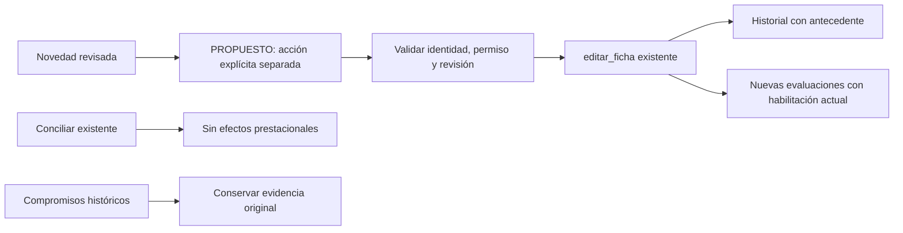

# Derechos operativos: plan de implementación
Objetivo: dar a Derechos una función real dentro del circuito del financiador, sin duplicar operaciones existentes ni inventar política asistencial. Estado: implementación y correcciones verificadas localmente; estrategia de entrega y revisión nativa pendientes.
Rama integradora: `juanikitro/DERECHOS`; base local: `65ef9c8ad8b93b7b959033d1d722b63350444537`. Estrategia acordada: `feature-branch-chain`, sólo local; sin publicación autorizada. Runners: Django aislado, PostgreSQL dedicado para concurrencia y Playwright contra entorno ficticio propio.

## Specs

- S1 — «crea un worktree nuevo llamado DERECHOS. Move este chat (tu chat) hacia ahi.» Crear un checkout independiente y conservar el trabajo ajeno. Actualización autorizada: «en caso de no poder mover este chat no importa, segui orquestando los agentes en ese worktree desde este». Continuar desde el chat existente con directorio DERECHOS explícito; no seguir intentando Computer Use ni afirmar que el chat se trasladó.
- S2 — «Relee y analiza tu analisis y propuesta para luego escribir un plan de implementacion.» Revisar críticamente la propuesta anterior contra código actual y distinguir evidencia, alternativas y decisiones pendientes.
- S3 — «Despliega los agentes que necesites y delega el desarrollo para ser profesional y eficiente». Delegar unidades coherentes y verificables; no lanzar escritores sobre un comportamiento de negocio aún indefinido. Corrección de modelo: «no, utiliza gpt-6-luna»; usar `gpt-6-luna` para la unidad completa con el esfuerzo `high` del escritor ODD.
- S4 — «el objetivo de ese agente es analizar el modulo "regla de derechos" (o borradores) para entender que debemos hacer para que deje de ser borradores y pase a ser un modulo funcional, real, practico y usable.» El resultado objetivo es un recorrido operativo real, no otro configurador aislado ni una simulación presentada como operación.
- S5 — «Para eso necesito que lo contraste con el resto del portal de financiador. Teniendo en cuenta su naturaleza, analiza si es mejor vincularlo mas a las reglas de cobertura.» Reutilizar padrón, novedades, planes, cobertura y autorizaciones; conservar separación entre elegibilidad de persona y cobertura de una prestación.
- S6 — «Puede existir la posibilidad de modificar mucho el modulo, ya que actualmente parece bastante inutil. El objetivo del nuevo agente es que encuentre un lugar real al modulo de derechos en el flujo real del financiador en el sistema, me lo explique y me lo grafique». Una modificación grande es una posibilidad, no una obligación ni autorización para inventar políticas.
- S7 — «confirmo el primer corte despues delegando la unidad completa». Confirma la propuesta inmediatamente anterior: «novedad revisada → cambio explícito de cobertura → historial enlazado», conservando permisos y compromisos anteriores, sin automatizar gracia, mora ni otras reglas indefinidas. Unidad completa: código, pruebas y documentación; verificación independiente posterior.

## Tasks

- T0 | S1 | inline, CLI/UI de Orca | COMPLETO con alcance actualizado: worktree creado; usuario acepta orquestar desde este chat sin trasladarlo | Sin commit; base indicada arriba; L11.
- T1 | S2,S4-S6 | delegated, mapa acotado + una impugnación independiente de premisa de alto impacto | COMPLETO: revisión estática y este plan | Sin pruebas ejecutadas ni commit.
- T2 | S2-S7 | inline, decisión de producto | COMPLETO: primer corte confirmado en L12 | No autoriza política automática.
- T3 | S3-S7 | delegated, un escritor para la unidad vertical; delegación solicitada expresamente | IMPLEMENTADO LOCALMENTE: B1-B3 corregidos y revalidados, L17 | Sin commit; pendiente estrategia de entrega.
- T4 | S3-S7 | delegated, verificador independiente por datos/permisos/concurrencia | VERIFICACIÓN FUNCIONAL COMPLETA CON LIMITACIONES: B1-B3 cerrados; spot check del padre aprobado | Suite completa fallida también en base; demo visible bloqueada por política del runtime; revisión nativa y aceptación humana pendientes.
- T5 | S4-S6 | por resolver tras contrato de la primera regla | CONDICIONAL: política operativa acotada, fechas y consumidores; no habilitada por T3 | Sin implementación ni estimación cerrada.

## Log

### L1 — Pedido de continuación, 12/11/2026

> crea un worktree nuevo llamado DERECHOS. Move este chat (tu chat) hacia ahi. Relee y analiza tu analisis y propuesta para luego escribir un plan de implementacion. Despliega los agentes que necesites y delega el desarrollo para ser profesional y eficiente

Reintento solicitado tras interrupción de Computer Use: «intentalo nuevamente».

### L2 — Objetivo original, conservado literalmente

> Quiero que despliegues otra sesion, pero con un agente mas inteligente, utiliza gpt-6-astra en esfuerzo muy alto. el objetivo de ese agente es analizar el modulo "regla de derechos" (o borradores) para entender que debemos hacer para que deje de ser borradores y pase a ser un modulo funcional, real, practico y usable. Para eso necesito que lo contraste con el resto del portal de financiador. Teniendo en cuenta su naturaleza, analiza si es mejor vincularlo mas a las reglas de cobertura. Puede existir la posibilidad de modificar mucho el modulo, ya que actualmente parece bastante inutil. El objetivo del nuevo agente es que encuentre un lugar real al modulo de derechos en el flujo real del financiador en el sistema, me lo explique y me lo grafique

### L3 — Aislamiento y estado observado

- Orca creó `DERECHOS` desde su base configurada `origin/main`, sin hooks de setup, sin lanzar otro chat y sin copiar cambios de `Issues-3`. El HEAD local coincide con la base del análisis; no se hizo fetch ni se afirma frescura remota de la rama.
- El worktree nuevo está separado del árbol compartido. No copiar, resetear, guardar en stash ni integrar cambios no publicados de la otra sesión.
- La CLI instalada solo expone `chat rename`; los menús de pestaña y configuración inspeccionados no ofrecieron trasladar el chat a otro worktree. Tras el reintento, la asociación visual sigue en Issues. No se editaron bases ni archivos internos de Orca para forzarla.
- Todas las operaciones de este plan usan el directorio DERECHOS explícitamente. Engram resolvió ese directorio al proyecto `sistemadesalud`.
- No apareció AGENTS.md en raíz ni ancestros. Se conservan las instrucciones suministradas por el usuario. Se inicializó un índice CodeGraph propio; no se copió el índice de Issues-3.
- El nuevo árbol no contiene `.atl/skill-registry.md`; se reutilizaron rutas exactas del registro inspeccionado en la sesión anterior, sin atribuirle instrucciones locales nuevas.

### L4 — Revisión crítica: qué cambia respecto de la propuesta anterior

**Corrección principal:** una resolución humana genérica no es, por sí sola, una nueva capacidad. La habilitación manual ya funciona desde la ficha.

| Evidencia actual | Consecuencia para el diseño |
| --- | --- |
| `frontend/src/components/financiadores/padronCampos.js:10-17` y `FichaPadronAdministrativa.jsx:50-65`: habilitación editable con motivo e historial | No crear otro interruptor con un nombre nuevo. |
| `backend/apps/financiadores/padron.py:189-255`: permiso, locks, revisión, validación y registro | Reutilizar `editar_ficha`, no escribir Afiliado por una vía paralela. |
| `backend/apps/financiadores/vigencias.py:120-152`: finalizar ahora/reactivar desde hoy | No confundir estas operaciones con fechas asistenciales futuras, retroactivas o gracia. |
| `backend/apps/financiadores/models.py:266-278` y `padron.py:120-126`: historial con origen y referencia a Importacion | Investigar la reutilización de trazabilidad antes de agregar una entidad DecisionDerechos. |
| `backend/apps/financiadores/novedades.py:95-121`: conciliación sin efectos | Mantener intacto el contrato existente; una nueva acción tendría que ser distinta y explícita. |
| `backend/apps/financiadores/cobertura.py:111-189` y `autorizaciones.py:137-151`: consumidores de la habilitación existente | Un primer enlace al booleano actual no necesita reescribir el motor de cobertura. |
| `backend/apps/financiadores/test_habilitacion_cobertura.py:42-75`: no retroactividad y compromisos anteriores | Mantener estos invariantes; el estado actual no sustituye la evidencia histórica. |

La propuesta de una consulta común de derechos sigue siendo un posible destino, no una refactorización obligatoria ahora. Selección, solicitud, reenvío, reserva y hecho histórico tienen cortes temporales diferentes. Una última decisión global no debe reemplazarlos indiscriminadamente.

### L5 — Evidencia de negocio y límites vigentes

Fuentes leídas en GitHub durante esta sesión: [#141](https://github.com/Mkdir-arg/SistemaDeSalud/issues/141), [#143](https://github.com/Mkdir-arg/SistemaDeSalud/issues/143), [#216](https://github.com/Mkdir-arg/SistemaDeSalud/issues/216), [#219](https://github.com/Mkdir-arg/SistemaDeSalud/issues/219), [#215](https://github.com/Mkdir-arg/SistemaDeSalud/issues/215), [#144](https://github.com/Mkdir-arg/SistemaDeSalud/issues/144) y [#145](https://github.com/Mkdir-arg/SistemaDeSalud/issues/145).

- Existe necesidad documentada de distinguir hechos administrativos, derechos, plan y autorización; no prueba de que OSTEL requiriera un módulo autónomo de borradores.
- Las respuestas del 06/11 y notas del 11/11 aclararon FECING/FECBAJ frente a FECHA_A, FECVTO y MOTIVO. No equivalen a una política asistencial completa ni fijan un corte de cobertura.
- Continúan sin acordar la primera regla operativa, efectos, autoridad, evidencia, excepciones y tratamiento temporal. La firma humana no reemplaza esas definiciones.
- Cobranza declarada no equivale a saldo conciliado. No usar facturas, deuda informada, parentesco, ausencia en lote o un plazo simulado como disparador automático.
- La aprobación previa del nombre y del diseño visual no autoriza efectos médicos. Las decisiones no resueltas no se convierten en requisitos por incluirlas aquí.

### L6 — Primera entrega candidata: integración explícita de una novedad

**Propuesta pendiente de aceptación, no alcance ya elegido.** Agregar una acción separada desde una novedad revisada para habilitar/deshabilitar inmediatamente la cobertura existente, conservando las atribuciones actuales y enlazando el antecedente al historial.

Su valor diferencial sería la trazabilidad del recorrido completo; no una nueva decisión legal ni la activación de las reglas de borrador. Es una primera pieza útil, pero no completa gracia, mora ni cambios de alcance por régimen.



Contrato a cerrar antes de T3:

1. Confirmar que este recorrido es la primera capacidad deseada y qué estado de revisión habilita la acción. Conciliar no equivale a aprobar derechos.
2. Mantener la acción inmediata y explícita, sin escoger el valor a partir del código del movimiento. Habilitar no reactiva una afiliación finalizada ni anticipa una futura.
3. Reutilizar el permiso actual de edición del padrón, sin ampliar acceso clínico ni modificar roles por inferencia.
4. Definir reintento, resultado incierto, no-op, conflicto y rectificación. El control de revisión por sí solo no acredita idempotencia. No guardar una referencia estructural solo como texto dentro del motivo.
5. Conservar al menos evidencia de antecedente, valores anterior/nuevo y autor real; evitar que una edición posterior de la novedad reescriba el fundamento de una operación pasada.

No aprobar estos puntos por omisión. Si el usuario necesita una regla automática como primer resultado, sustituir esta candidata por un caso concreto de T5, no construirla como relleno.

### L7 — Diseño técnico y límites de la unidad candidata

Reutilizar `editar_ficha`, `comprobar_revision`, `requerir_financiador`, `registrar_historial` y `autor_real`. Verificar que la novedad, su afiliado y la organización coincidan. Revisar el orden de locks con el circuito de novedades antes de agregar una transacción compuesta.

La relación `HistorialAfiliacion.lote` con `Importacion` es un punto de reutilización plausible, no una decisión de esquema cerrada. Validar su serialización, presentación y estabilidad frente a rectificaciones antes de adoptarla. Si resulta insuficiente, plantear la diferencia necesaria, no sobrecargar silenciosamente el contrato.

Superficies candidatas para el único escritor vertical, todavía no asignadas:

```text
backend/apps/financiadores/novedades.py
backend/apps/financiadores/novedades_api.py
backend/apps/financiadores/test_novedades.py
backend/apps/financiadores/test_habilitacion_cobertura.py
frontend/src/pages/financiadores/NovedadesFinanciador.jsx
frontend/src/components/financiadores/HistorialPadron.jsx
frontend/e2e/novedades-real.spec.js
frontend/e2e/fixtures/preparar_novedades_real.py
frontend/playwright.derechos-real.config.js
docs/funcionalidades/financiadores-cobertura/ostel-aceptacion.md
```

No autorizar por defecto modelos/migraciones, permisos, familias, importadores, reglas de cobertura, borradores ni motor financiero. El padre debe revisar cualquier ampliación. `NovedadesFinanciador.jsx` también está siendo modificado en Issues-3: no copiar su trabajo pendiente. Reconciliar la versión publicada antes de integrar ramas.

### L8 — Verificación prevista, todavía no ejecutada

Aplicar RED → GREEN → REFACTOR para cada comportamiento acordado mediante interfaces públicas. Observar salida HTTP, cambios persistidos y ausencia de efectos en rechazos. Conservar conciliación sin efectos y las pruebas históricas anteriores.

Casos mínimos propuestos: operador permitido; auditor/revocado/otra organización rechazados; revisión obsoleta; evidencia/afiliado contradictorios; reintento idéntico y distinto; doble confirmación; rectificación posterior; nueva evaluación tras el cambio; compromiso previo intacto. Ajustar la lista a las decisiones concretas, sin convertirla en un catálogo universal.

Desde `backend`, en entorno aislado preparado exclusivamente para DERECHOS:

```powershell
$env:DJANGO_DEBUG = "true"
python -B manage.py test apps.financiadores.test_novedades apps.financiadores.test_habilitacion_cobertura apps.financiadores.test_vigencias apps.financiadores.test_derechos_padron_aislamiento --settings=config.settings_financiadores_test --noinput
python -B manage.py test apps.financiadores --settings=config.settings_financiadores_test --noinput
```

El settings anterior usa SQLite en memoria: no prueba locks PostgreSQL. Con instancia local descartable propia, nunca compartida con Issues-3, y `SALUD_TEST_POSTGRES_URL` autorizada para esa instancia:

```powershell
python -B manage.py test apps.financiadores.test_novedades.NovedadesConcurrenciaTests apps.financiadores.test_concurrencia_padron130 --settings=config.settings_financiadores_postgres_test --noinput
```

Extender la clase o agregar los casos de concurrencia propios antes de atribuir cobertura a esos comandos. No ejecutar dos procesos sobre la misma base de test.

Para navegador, `frontend/e2e/novedades-real.spec.js` requiere manifest sintético `SALUD_NOVEDADES_MANIFEST` y servidor loopback. Sin manifest se omite: un comando exitoso con skips no acredita el recorrido. Preparar configuración focalizada, backend/frontend y puertos propios; no reutilizar ni detener la demo 8230 de Issues-3. Verificar escritorio, móvil, teclado, errores, recarga e historial con datos ficticios. Mostrar luego la pantalla en navegador visible, sin confundir demostración con aceptación.

Si se cambia código compartido, comparar las entradas existentes afectadas en baseline y candidato, usando scratch externo y datos sintéticos aislados. No consultar Git desde pruebas de regresión comprometidas.

### L9 — Delegación, cortes y riesgo

- T1: mapa por GPT-6 Astra, esfuerzo muy alto; desafío independiente por GPT-6.1 Sol, esfuerzo medio. Ambos entregaron y el padre comprobó `padron.editar_ficha`/historial en la base nueva.
- T3: un escritor delegado con código, tests y documentación de la misma conducta. Backend y UI son dependientes: no repartirlos entre escritores concurrentes para aparentar paralelismo. El padre conserva Git y revisa superficies.
- T4: un verificador independiente por modificación de datos existentes, controles de acceso y concurrencia; checks propios primero. Un spot check del padre antes de la entrega. La revisión nativa es adicional y solo se inicia según su evaluación y consentimiento aplicables; no se altera el switch.
- Estimación orientativa de T3+pruebas+documentación: 450–800 líneas autorales, por validar al cerrar el contrato. `ask-on-risk`: elegir estrategia de cadena antes del primer commit si se confirma ese tamaño. La opción recomendada sería integrar cortes coherentes en rama de funcionalidad, no fragmentar artificialmente tests y código. No hay estrategia de publicación elegida todavía.
- Risk previsto para implementación: items 1, 2, 3 y 4, a acotar al diff real. No hay cambios funcionales en este plan. No se ejecutaron pruebas ni se atribuye aprobación clínica, CI, merge o despliegue.

### L10 — Puerta de decisión y continuación

**Necesita decisión:** confirmar si la primera entrega será el enlace explícito novedad → cambio inmediato de habilitación con trazabilidad, o si debe comenzar por una regla asistencial concreta. En el segundo caso, acordar un ejemplo con actor, evidencia, efecto y fecha antes de desarrollar.

Tras la respuesta, registrar su texto literal, actualizar solo los specs/tareas afectados, cerrar el contrato mínimo y despachar al escritor. No pedir una aprobación genérica para cada paso técnico. No activar reglas inventadas, ni crear infraestructura aislada para evitar esta decisión.

Localizador del espejo Engram: `odd/derechos-operativos/tasks`, proyecto `sistemadesalud`. La confirmación de persistencia se verifica con el recibo y su lectura; este localizador solo no la acredita. Este archivo es el plan único; no duplicarlo en otro documento de planificación.

### L11 — Continuidad sin traslado del chat, 12/11/2026

> te detuve para poder frenar el computer use tranquilo. en caso de no poder mover este chat no importa, segui orquestando los agentes en ese worktree desde este

Se da por terminada la tentativa de traslado. El chat conserva su asociación visual y el trabajo sigue en DERECHOS mediante rutas explícitas. T0 queda completo por la modificación expresa del alcance; la decisión de producto de T2 sigue pendiente. No se lanzaron escritores funcionales ni se ejecutaron pruebas. Los dos agentes de análisis terminaron; no hay desarrollo corriendo en segundo plano.

### L12 — Primer corte confirmado, 12/11/2026

> confirmo el primer corte despues delegando la unidad completa

La confirmación cierra T2 y sustituye el estado de propuesta pendiente de L6/L10. Se autoriza implementar la unidad vertical definida, no el motor normativo T5. Interpretación conservadora de «revisada»: novedad en estado `conciliada`; una novedad pendiente, descartada, conflictiva o rectificada no habilita por sí sola esta nueva acción. La conciliación conserva su respuesta sin efectos.

Contrato técnico de aceptación para el escritor:
- Acción separada con booleano elegido explícitamente, motivo y revisiones vigentes. Permisos existentes de escritura del padrón, aislamiento por financiador e identidad exacta del afiliado.
- Efecto inmediato sobre el booleano existente, sin finalizar/reactivar, cambiar plan ni extender derechos familiares. No elegir resultado desde códigos, fechas o datos declarativos.
- Verificar idempotencia y resultado incierto con evidencia persistida/correlación adecuada al código existente. Reintento idéntico no duplica ni reaplica un cambio tras otra edición; solicitud incompatible o estado/revisión obsoletos rechazan sin escrituras parciales. Un no-op debe explicarse sin fabricar una transición en el padrón.
- Historial enlazado y fundamento preservado aunque la novedad se rectifique después; nunca reescribir compromisos históricos. Reutilizar `editar_ficha` y auditoría actuales. Si la correlación existente no puede garantizar estos contratos, devolver una ampliación de superficie concreta antes de introducir una migración o una nueva entidad.
- Interfaces de verificación: API pública de la acción y consultas públicas de novedad/historial, más recorrido real de navegador y regresiones existentes de cobertura. Comprobar permisos, revisión, doble envío, no-op, conflicto, rectificación y no retroactividad.
- Setup local aislado y dependencias prescritas permitidos para las pruebas; no usar bases, puertos, contenedores o credenciales de Issues-3. No modificar manifests/dependencias/globales. Sin publicaciones ni accesos a producción. No Computer Use.

El padre conserva Git y el documento. No hacer commits desde el escritor: la estrategia de cadena se resolverá antes del primer commit si el diff supera la previsión del presupuesto. No dividir una única conducta entre writers de backend, UI y tests.

### L13 — Despacho rechazado por modelo no disponible, 12/11/2026

La lectura confirmó que archivo y espejo #3084 coinciden. RDD está habilitado por configuración global. Se intentó despachar `rights_vertical_slice` con la asignación exacta de ODD (`gpt-6.1-luna`, `high`), pero el runtime devolvió `Unknown model`. No creó un agente. Ofrece `gpt-6.1-sol`, `gpt-6-astra`, `gpt-6.1-terra`, `gpt-6-sol` y `gpt-6-luna`. Los agentes del análisis anterior ya no aparecen activos. No sustituir silenciosamente el modelo ni ejecutar la unidad inline contra la delegación solicitada. Se solicita autorizar `gpt-6-astra` con esfuerzo `xhigh` para la unidad completa; la aprobación de producto sigue vigente. Sin código, pruebas, entorno nuevo ni commits en este intento.

### L14 — Modelo confirmado por el usuario, 12/11/2026

> no, utiliza gpt-6-luna

Esta instrucción sustituye la asignación no disponible del escritor y rechaza la alternativa Astra. Se mantiene el esfuerzo `high` y todo el alcance aprobado en L12. No cambia permisos remotos, política de derechos ni superficies autorizadas.

### L15 — Primera entrega del escritor y prueba pendiente, 12/11/2026

El escritor devolvió `partial`: 66 pruebas focales SQLite (4 skips), 15 de concurrencia PostgreSQL, 8 Playwright escritorio/móvil y build Vite aprobados. Suite completa: 876 pruebas, 60 skips, 1 fallo y 3 errores; salida no conservada completa. No atribuirlos a la base sin reproducción. Informó RED por endpoint 404, pero no conservó invocación exacta. No ejecutó diferencial base/candidato ni demostración visible. Las superficies observadas coinciden con L7; no cambió modelos ni migraciones.

La revisión nativa preliminar devolvió `high`/`unassessable`: exige declarar los dos archivos untracked (config Playwright y este documento). Esto no es PASS ni consentimiento. La operación compone locks de novedad/padrón y afecta permisos/contrato compartido; requiere verificador independiente y reconciliar el alcance contra L12. El padre conserva el diff sin commits. El contenedor de pruebas propio sigue disponible; no usa datos reales ni recursos de Issues-3.

### L16 — Verificación independiente y único lote de correcciones, 12/11/2026

El verificador `gpt-6.1-sol`/`medium` reprodujo B1: la nueva acción acepta evidencia rectificada o con conflictos actuales; B2: deadlock PostgreSQL con PATCH de padrón por `Financiador FOR UPDATE` y FK de auditoría; B3: UI interpreta booleano histórico ausente como deshabilitado. Corregir exactamente estos grupos y guardar sus probes como pruebas de regresión en las superficies existentes. Mantener replay idempotente antes de rechazar evidencia posteriormente obsoleta. Revisar modo/orden de locks sin reestructurar circuitos ajenos. Mostrar dato histórico no registrado, sin backfill ni modificar snapshots.

La suite completa candidata y base reprodujo los mismos cuatro fallos: manifest estático de admin; dos pruebas PostgreSQL ejecutadas contra SQLite; orden de borradores en historial. No son causados por esta unidad y no se corrigen aquí. El verificador aprobó 15 pruebas PostgreSQL, 8 de navegador, invariantes de permisos/replay y diferencial de APIs previas. La suite completa no está verde. Raíz de evidencia externa: `derechos-verify-da4ea1a235164a90ba2677945de6fc87` bajo TEMP, con logs completos y probes. No copiar manifiestos con credenciales sintéticas al repositorio. Tras corrección, recheck sólo de B1-B3, más spot check del padre. No repetir un barrido nuevo de hallazgos.

### L17 — Correcciones verificadas y entrega pendiente, 12/11/2026

El escritor realizó el único lote de correcciones. La verificación independiente limitada confirmó: tres rechazos 400 sin cambios persistidos; replay 200 sin escrituras incluso tras edición opuesta y rectificación; concurrencia PostgreSQL PATCH 200/acción 400 sin deadlock; navegador histórico muestra «Cobertura: No registrado». Pruebas persistentes incorporadas al repositorio. El escritor pasó 10 recorridos Playwright escritorio/móvil y 5 pruebas PostgreSQL de novedades. El padre repitió `python -B manage.py test apps.financiadores.test_novedades apps.financiadores.test_habilitacion_cobertura --settings=config.settings_financiadores_test --noinput`: 33 pruebas, OK con 5 skips de concurrencia SQLite. `git diff --check` sin errores; superficies respetadas.

Evidencia del recheck en TEMP `derechos-recheck-28318844732b4ca9926a0f317270be34`. Se conservan temporalmente los snapshots/logs y el contenedor ficticio propio `derechos-novedades-pg`, loopback 54697, para continuidad; ningún servidor de prueba escucha en 8231/5179. El intento del padre de preparar la demo visible mediante procesos locales ocultos fue rechazado antes de ejecutar por la política del runtime. No se reintentó por otro mecanismo ni se usó Computer Use. No hay demo visible ni aceptación humana acreditada.

Diff observado: 521 líneas cambiadas en archivos tracked, más 50 del config nuevo y este plan (más de 400 en total). Antes del primer commit, resolver una vez `ask-on-risk`: `feature-branch-chain` recomendada para mantener la entrega integrada, o `stacked-to-main`. Esto solo define organización local; no autoriza publicar PR, push, merge ni deploy. Después corresponde assessment con archivos untracked declarados o commits exactos y consentimiento nativo si se ofrece. RDD sigue habilitado; no hay aprobación nativa ni commit.

Risk: items 2, 3 y 4 — permisos, comportamiento compartido de novedades/padrón y composición concurrente. Sin migraciones ni cambios de datos reales. Persistencia nueva sobre JSON existente no se presenta como migración de formato previo.

### L18 — Cadena funcional elegida, 12/11/2026

> 1

La respuesta selecciona «Cadena hacia rama funcional» de la pregunta precedente. Se fija `feature-branch-chain`; no es autorización para publicar, abrir PR, fusionar, desplegar ni mover la rama integradora a contenido sin revisar.

Una pasada de partición propone tres cortes locales coherentes, cada uno con base en el anterior:

| Corte | Rama | Resultado autónomo y frontera de rollback | Verificación |
| --- | --- | --- | --- |
| 1 | `juanikitro/DERECHOS-01-plan` | Especificación y registro de decisiones; sólo este documento | Lectura estructural y espejo |
| 2 | `juanikitro/DERECHOS-02-api` | Acción pública explícita, idempotencia, guardas e historial; servicio/API/tests y documentación de ese contrato | Focal Django, PostgreSQL, diferencial y verificación independiente L16/L17 |
| 3 | `juanikitro/DERECHOS-03-ui` | Recorrido visible e historial enlazado; componentes, fixtures, E2E/config y documentación de UI | Playwright escritorio/móvil y build; limitación de demo visible L17 |

Las ramas son referencias locales, no PR existentes. La integradora permanece en la base hasta autorización posterior. Cada corte operativo conserva sus pruebas y documentación; no se divide una conducta entre código y pruebas. Se consolidan las notas de aceptación para separar evidencia actual de los fallos iniciales ya corregidos, preservados en este Log. No se eliminan pruebas ni se comprime código para reducir líneas. Commits y assessment se registrarán tras observarlos.
